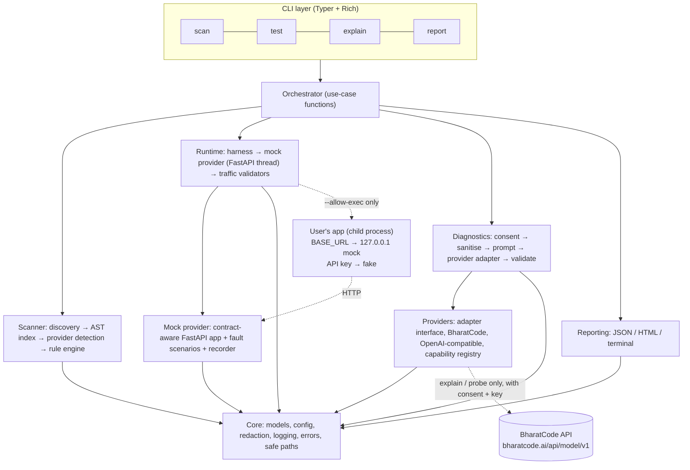

# FlightCheck architecture

This is the living description of how FlightCheck is structured. Together with
[DECISIONS.md](DECISIONS.md) it is the source of truth: if the two disagree, the newer ADR wins and
this file is corrected in the same commit.

**Current state (Phase 7B):** `src/flightcheck/__init__.py`, `__main__.py`, `cli/app.py` (with
`--version`), the `core` package (`models`, `config`, `errors`, `logging`, `redact`, `paths`,
`capabilities`, `contract`) and the scanner (`scanner/discovery`, `ast_utils`, `parser`,
`detect`, `engine`, `rules/{bharatcode,robustness,security}`), `orchestrator.run_scan`,
`reporting/{json_report,terminal}` and the `scan` command exist, plus the complete mock
provider (`mock/{faults,payloads,recorder,app,server}`: JSON and SSE answers, `MockServer` on
127.0.0.1; the payload fields the OpenAI SDK needs are listed in §8) and the provider layer
(`providers/{capabilities,base,http,sse,bharatcode,registry}`: `BharatCodeAdapter`,
`build_adapter`, `BHARATCODE_PROFILE`; sync, raw httpx2, injected transport and sleep; ADR-016,
ADR-028), and the runtime layer (`runtime/{harness,scenarios,validators}`: consented child process with a scrubbed environment and a best-effort egress guard, which is not a sandbox; scenarios S01–S06; checks FC-RT-001…008, 011…014, 020, 022, 023, 030, 040, 041, 050, 060; `[test.expect]` expectations) driven by `orchestrator.plan_test` / `run_test` and the `flightcheck test` command (warning panel, per-scenario table, `--keep-traffic`; ADR-017, ADR-018, ADR-029, ADR-030). `runtime/harness.py` is the only module that imports `subprocess`. The generic OpenAI-compatible adapter and the `providers` command (P1) do not exist
yet. Contract facts shared by the scanner, the mock and the adapter live in `core.config` and
`core.contract` (ADR-027, ADR-028); capability types live in `core.capabilities`. Conventions settled while building `core` are in ADR-023; scanner resolution and detection
rules are in ADR-011 and ADR-024. Everything else below is the target design. Modules are created
in the phase that first gives them real code; there are no placeholder modules.

## 1. Shape of the system

A **modular monolith**: one installable package, one process. Only during `test` are there extra
moving parts: one mock-server thread and one consented child process running the user's app.



## 2. Data flow per command

| Command                            | Flow                                                                                                                                                 | Network                      | Executes repo code    |
| ---------------------------------- | ---------------------------------------------------------------------------------------------------------------------------------------------------- | ---------------------------- | --------------------- |
| `scan PATH`                        | discover → parse → index → detect → rules → `Report(kind=scan)` → terminal + optional JSON/HTML                                                      | none                         | no                    |
| `test PATH --allow-exec`           | load `flightcheck.toml` → per scenario: start mock with scenario script → run app command → collect traffic → validators → `Report(kind=test)`       | localhost only               | **yes, with consent** |
| `explain REPORT.json`              | load report → select findings → consent summary → sanitise → call BharatCode (or `--no-llm` / fake) → validate → attach `ai_suggestions` → new report | BharatCode only with consent | no                    |
| `report REPORT.json --format html` | load → render                                                                                                                                        | none                         | no                    |
| `probe` (P1)                       | adapter → documented probes → `runtime-live` checks → sanitised golden transcripts                                                                   | BharatCode                   | no                    |

## 3. Import boundaries

Enforced by an import test from Phase 11.

```text
core          → (stdlib, pydantic only)
scanner       → core
mock          → core
runtime       → core, mock
providers     → core
diagnostics   → core, providers
reporting     → core
orchestrator  → core, scanner, runtime, diagnostics, reporting, providers
cli           → orchestrator, reporting, core
```

No module may import `cli`. `scanner` must never import `providers` or `runtime`, nor
`subprocess`, `importlib` or `runpy`: `scan` stays network-free and execution-free by
construction.

## 4. Components

| #   | Component                  | Module(s)                                         | Responsibility                                                                    | Public interface (MVP)                                         | P   |
| --- | -------------------------- | ------------------------------------------------- | --------------------------------------------------------------------------------- | -------------------------------------------------------------- | --- |
| 1   | CLI layer                  | `cli/app.py`, `cli/render.py`                     | Parse args, call orchestrator, render, map exceptions to exit codes. No logic.    | `main()`, Typer `app`                                          | P0  |
| 2   | Orchestrator               | `orchestrator.py`                                 | One function per use case; wires components; no I/O formatting.                   | `run_scan`, `run_test`, `run_explain` (request → `Report`)     | P0  |
| 3   | Repository discovery       | `scanner/discovery.py`                            | Safe file walk, exclusions, limits, repo metadata.                                | `discover(root, options) -> DiscoveryResult`                   | P0  |
| 4   | Provider detection         | `scanner/detect.py`                               | Classify client constructions and call sites.                                     | `detect_providers(index) -> list[ProviderDetection]`           | P0  |
| 5   | Provider adapter interface | `providers/base.py`                               | Abstract base + normalised types.                                                 | `ProviderAdapter`                                              | P0  |
| 6   | BharatCode adapter         | `providers/bharatcode.py`                         | Live calls with BharatCode pre-flight validation, stream handling, error mapping. | `BharatCodeAdapter`                                            | P0  |
| 7   | OpenAI-compatible adapter  | `providers/openai_compat.py`                      | Conservative pass-through; capabilities `unknown` unless probed or declared.      | `OpenAICompatibleAdapter`                                      | P1  |
| 8   | Capability registry        | `providers/capabilities.py`                       | Profiles: capability → support level + source.                                    | `get_profile(provider) -> CapabilityProfile`                   | P0  |
| 9   | Static rule engine         | `scanner/engine.py`, `scanner/rules/*.py`         | Rule registry, execution, ordering, filtering.                                    | `@rule(...)`, `run_rules(index, config) -> list[Finding]`      | P0  |
| 10  | Workflow validator         | `runtime/validators.py`                           | Assertions over recorded traffic.                                                 | `validate_traffic(traffic, scenario) -> list[CheckResult]`     | P0  |
| 11  | Mock provider              | `mock/app.py`, `payloads.py`, `recorder.py`, `server.py` | Contract-aware fake BharatCode API; recording; thread runner.              | `create_mock_app(script, recorder)`, `MockServer`              | P0  |
| 12  | Failure simulation         | `mock/faults.py`, `runtime/scenarios.py`          | Scripted per-request behaviours; scenario catalogue + expectations.               | `FaultScript`, `SCENARIOS`                                     | P0  |
| 13  | AI diagnostic service      | `diagnostics/*.py`                                | Consent, sanitisation, prompting, validation, fallback.                           | `DiagnosticService.explain(report, options)`                   | P0  |
| 14  | Report generation          | `reporting/*.py`                                  | JSON (schema-versioned), HTML, terminal.                                          | `write_json`, `render_html`, `render_terminal`                 | P0  |
| 15  | Configuration              | `core/config.py`                                  | Merge defaults ← `flightcheck.toml` ← env ← CLI flags; secrets never in `repr`.   | `load_config(root, overrides) -> FlightCheckConfig`            | P0  |
| 16  | Logging & errors           | `core/logging.py`, `core/errors.py`               | Redacting log filter; exception hierarchy with user-facing hints.                 | `get_logger`, `FlightCheckError` subclasses                    | P0  |
| 17  | CI integration             | `.github/workflows/*.yml`, `docs/CI.md`           | Gate builds on findings.                                                          | exit codes 0/1/2/3                                             | P0  |
| 18  | Live probe                 | `probe/live.py`                                   | Documented-behaviour probes against BharatCode.                                   | `run_probes(adapter) -> list[CheckResult]`                     | P1  |
| 19  | Runtime harness            | `runtime/harness.py`                              | Consent-gated subprocess runner with scrubbed env and timeouts.                   | `run_app(command, env, timeout) -> AppRun`                     | P0  |

## 5. Packages and layers

| Package           | Layer              | Responsibility                                    | Depends on                    |
| ----------------- | ------------------ | ------------------------------------------------- | ----------------------------- |
| `cli`             | CLI                | Argument parsing, rendering, exit codes           | orchestrator, reporting, core |
| `orchestrator.py` | application        | Use-case wiring                                   | all below                     |
| `core`            | core/configuration | Models, config, errors, logging, redaction, paths | stdlib, pydantic              |
| `scanner`         | scanner            | Discovery, AST index, detection, rules            | core                          |
| `providers`       | provider           | Adapters, capabilities, HTTP, SSE                 | core, httpx2                  |
| `mock`            | testing            | Contract mock, faults, recording                  | core, fastapi, uvicorn        |
| `runtime`         | testing            | Harness, scenarios, validators                    | core, mock                    |
| `diagnostics`     | provider/AI        | Explain pipeline                                  | core, providers               |
| `probe`           | provider           | Live probes                                       | core, providers               |
| `reporting`       | reporting          | JSON/HTML/terminal                                | core, jinja2, rich            |

## 6. Target repository layout (condensed)

```text
BharatCode.txt  README.md  CLAUDE.md  pyproject.toml  .gitignore
.github/workflows/ci.yml               ruff + pytest on 3.11/3.12/3.13 (dogfood scan from Phase 9)
docs/                                  ARCHITECTURE, DECISIONS, IMPLEMENTATION_STATUS, QUALITY_GATES,
                                       BHARATCODE_CONTRACT, RULES, CI, EVALUATION, report.schema.json,
                                       handoffs/PHASE_XX.md
scripts/                               eval_fixtures.py, demo.sh
examples/bharatcode-weather-agent/     demo app with deliberate mistakes
src/flightcheck/
  __init__.py  __main__.py  orchestrator.py
  cli/         app.py, render.py
  core/        models, config, errors, logging, redact, paths
  scanner/     discovery, parser, ast_utils, detect, engine, rules/{bharatcode,robustness,security}
  providers/   base, capabilities, http (all httpx2 client creation), sse, bharatcode,
               openai_compat, registry
  mock/        faults, payloads, recorder, app, server
  runtime/     harness, scenarios, validators
  diagnostics/ schema, sanitize, context, prompt, fake_llm, service
  probe/       live.py
  reporting/   json_report, terminal, html_report, templates/report.html.j2
tests/         unit, scanner, providers, mock, runtime, diagnostics, cli, security, live,
               architecture, fixtures/ (rule fixtures, fixture apps, expected results, golden)
```

## 7. CLI surface (planned)

P0 commands: `scan PATH`, `test PATH --allow-exec`, `explain REPORT.json`, `report REPORT.json`.
P1: `ci`, `probe`, `init`, `providers`, `mock-server`. Global options: `--version`,
`-v/--verbose`, `-q/--quiet`, `--no-color`.

Exit codes: `0` completed with nothing at or above `--fail-on`; `1` completed with at least one
finding or failed check at or above `--fail-on`; `2` usage, configuration or consent error; `3`
internal or infrastructure error.

## 8. Mock payload fields the OpenAI SDK requires

Fields the official OpenAI Python SDK (3.46) marks as required, read from its pydantic models;
the mock sends all of them (`mock/payloads.py`). Anything beyond the documented BharatCode fields
is **[UNVERIFIED]** for BharatCode (ADR-015, ADR-027). When an SDK upgrade rejects a payload,
read the failing type's `model_fields` and update this list with the payload.

| Payload                                | Required fields                                                                                                                                         |
| -------------------------------------- | ------------------------------------------------------------------------------------------------------------------------------------------------------- |
| `Response`                             | `id`, `object`, `created_at`, `model`, `output`, `parallel_tool_calls`, `tool_choice`, `tools`                                                          |
| `ResponseUsage`                        | `input_tokens`, `input_tokens_details.{cached_tokens,cache_write_tokens}`, `output_tokens`, `output_tokens_details.reasoning_tokens`, `total_tokens` |
| output `message` / `output_text`       | `id`, `type`, `role`, `status`, `content`; `type`, `text`, `annotations`                                                                                |
| output `function_call`                 | `type`, `call_id`, `name`, `arguments`                                                                                                                  |
| `response.error` (failed)              | `code` (an SDK enum: the mock sends `server_error`), `message`                                                                                          |
| every Responses stream event           | `type`, `sequence_number`                                                                                                                               |
| `response.created` … `.failed`         | `response`                                                                                                                                              |
| `response.output_item.added` / `.done` | `output_index`, `item`                                                                                                                                  |
| `response.content_part.added` / `.done` | `item_id`, `output_index`, `content_index`, `part`                                                                                                      |
| `response.output_text.delta` / `.done` | `item_id`, `output_index`, `content_index`, `logprobs`, plus `delta` / `text`                                                                           |
| `response.function_call_arguments.*`   | `item_id`, `output_index`, plus `delta` / `arguments`                                                                                                   |
| `ChatCompletion`                       | `id`, `object`, `created`, `model`, `choices[].{index,message.role,finish_reason}`; usage `prompt_tokens`, `completion_tokens`, `total_tokens`           |
| `ChatCompletionChunk`                  | `id`, `object`, `created`, `model`, `choices[].{index,delta}`; `delta.tool_calls[].index`                                                               |
| `Model` (`GET /models`)                | `id`, `object`, `created`, `owned_by`                                                                                                                   |

The SDK's `responses.stream()` helper also needs `response.output_item.added` and
`response.content_part.added` before the first delta, so the mock sends them.

